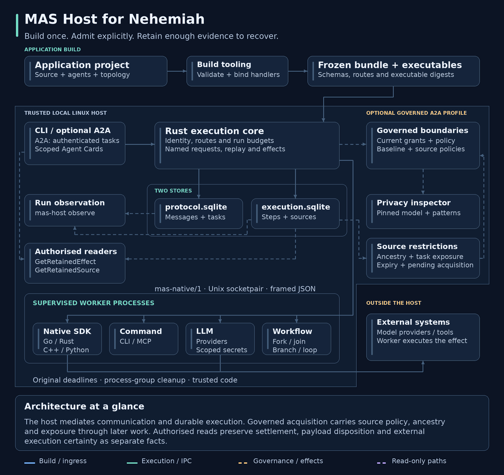

# MAS Host for Nehemiah

MAS Host runs native functions, CLI tools, LLMs and composable workflows through the
Nehemiah communication protocol. It gives Go, Rust, C++ and Python handlers the same
routing, admission and recovery rules. Existing `mas-*` identifiers remain stable.

An application supplies its functions or executable tools, then declares the agents and
permitted communication routes. The host generates executable entry points and
registration bundles from those declarations. The application keeps its ordinary build
metadata and tests.

The supported deployment is a **trusted local Linux profile**, built from source. Named
child requests and admitted effects provide durable checkpoints. After interruption, the
host reuses completed results and holds uncertain external actions for evidence-based
resolution. It consumes a pinned revision of
[`emmett08/mas`](https://github.com/emmett08/mas) through its public Rust crate,
preserving the protocol repository and existing demos as independent consumers.

## Architecture in motion

<picture>
  <source media="(prefers-reduced-motion: reduce)" srcset="docs/diagrams/mas-host-architecture.png">
  
</picture>

The animation follows build, admission, worker execution and recovery, including
the retained-effect reader from [PR #19](https://github.com/emmett08/mas-host/pull/19)
and governed acquisition with inherited source restrictions from
[PR #20](https://github.com/emmett08/mas-host/pull/20).
Packet motion shows the sequence of operations with illustrative timing.
The governed path applies to explicitly configured structured A2A operations.

[Static diagram](docs/diagrams/mas-host-architecture.svg) ·
[Flow explanation and regeneration](docs/diagrams/README.md) ·
[Architecture contracts](docs/architecture.md)

The [Nehemiah implementation sequence](docs/nehemiah-implementation.md) starts the
scaling, governed-data and PII plans with workload baselines, strict [profile
preflight](docs/nehemiah-governance.md) and synthetic privacy fixtures. Managed and
shared profiles report the enforcement capabilities still required. [Approved capability
packages](docs/capabilities.md) and the first [governed structured local
path](docs/governed-local.md) are available with explicit operator policy. Protected
deployment requires the remaining implementation and qualification gates in that
sequence.

[`mas-agents/3`](docs/llm-workflows.md) configures maintained OpenAI Responses,
OpenAI-compatible, Cursor SDK, command and explicit mock providers. Workflow
agents recursively compose sequences, parallel groups, branches, bounded loops,
foreach and named subworkflows. Star, tree and mesh routes can be combined in one
application. Every cross-agent request still passes through MAS admission.
The [composable examples](https://github.com/emmett08/mas-host-examples/tree/main/examples/composable-agents)
exercise these shapes with one actor definition and selectable provider profiles.
The [inference result contract](docs/inference-results.md) specifies how repeated,
conflicting and unusable provider outputs interact with validation and replay.

## Build and try an application

Prerequisites: Linux, Git, Rust **1.99.0**, a C compiler and Make. Rust is pinned in
`rust-toolchain.toml`. The protocol dependency builds bundled SQLite. Native Go
applications require Go **1.24.0 or later**, C++ applications require C++17, and Python
applications require Python **3.11 or later**. Full verification uses all four language
toolchains.

```sh
git clone https://github.com/emmett08/mas-host.git
cd mas-host
make build
```

Maintained runnable applications live in
[`mas-host-examples`](https://github.com/emmett08/mas-host-examples): Go, Rust,
C++, Python, ordinary CLI tools and composed LLM workflows. That repository pins
its host revision and documents setup, execution and recovery.

This repository keeps small compiler and recovery inputs under `tests/fixtures`. Host CI
uses them to check integration and recovery. The examples repository provides
application walkthroughs, while each SDK guide keeps concise API snippets beside its
implementation.

## An application repository

For Go, an exported handler has a typed signature:

```go
func Assess(ctx *mas.Context, proposal Proposal) (Assessment, error)
```

Its `agents.toml` selects the function:

```toml
version = "mas-agents/3"

[[agents]]
name = "assessor"
operation = "assess/1"
[agents.implementation]
kind = "native"
language = "go"
source = "."
handler = "Assess"
```

Its `topology.yaml` permits requests and replies:

```yaml
version: mas-topology/1
edges:
  - [client, assessor]
  - [assessor, client]
```

The application also has its ordinary `go.mod`, SDK dependency, source and tests. The
host supplies the worker entry point, registration and protocol codec. The CLI writes
generated files under `.mas/build/`, so add `.mas/` to the application's `.gitignore`.
Select `go`, `rust`, `cpp` or `python` in each native implementation binding. Every
binding follows the shared routing and admission contract.

| Language | Supported application signature/build profile |
|---|---|
| [Go](sdk/go/README.md) | Typed exported functions in an ordinary module, preserving requirements, replacements and checksums |
| [Rust](sdk/rust/README.md) | Standalone source functions using SDK `Context` and `Json`, with a generated Cargo entry point |
| [C++](sdk/cpp/README.md) | Standalone source functions using SDK `Context` and `Json`, with a generated C++17 entry point |
| [Python](sdk/python/README.md) | Typed functions using dataclasses or dictionaries, packaged with the SDK in a generated archive |

Python handlers receive ordinary application types:

```python
from dataclasses import dataclass
from mas_host import Context

@dataclass
class Proposal:
    units: int

@dataclass
class Assessment:
    accepted: bool

def assess(ctx: Context, proposal: Proposal) -> Assessment:
    return Assessment(accepted=proposal.units <= 100)
```

Bind this function with `language = "python"`, `source = "application.py"`,
and `handler = "assess"`. The [Python examples](https://github.com/emmett08/mas-host-examples/tree/main/examples/python-review)
include peer requests, durable effects and a typed caller that supplies input
without creating an input file.

TOML settings, YAML topology/workflows and typed SDK inputs share one validation
path. JSON remains available for generated configuration, schemas, stdin and
interchange. See [authoring formats](docs/authoring.md) for discovery, conversion
rules and recovery identity.

Full Cargo/CMake project discovery and arbitrary native type-to-schema generation are
future profiles. JSON values use exact integers. Represent decimal quantities with
scaled integers or strings. The SDK documentation gives each language's numeric bounds
and rejection rules.

The source distribution includes its generators and SDKs. For an application
outside this checkout, set `MAS_HOST_SDK_ROOT` to this repository's absolute path,
or supply `--sdk-root`. Copying only the host executable does not install those
build assets. A future packaged release should install them together.

## Ordinary command-line tools

A `command` implementation declares an executable, separate argument bindings,
stdin and stdout formats, accepted exit codes and bounded execution limits.
Its operation declares input/output schemas independently of the implementation.
The host adapts that tool to MAS and journals each invocation as an admitted effect.
The tool needs no SDK or protocol implementation.

See the [command contract](docs/commands.md) and the [CLI
example](https://github.com/emmett08/mas-host-examples/tree/main/examples/command-policy).
An LLM can select these operations through its declared delegates. An application MCP
client adapter exposes custom MCP tools through the same path, as described in [MCP tool
integration](docs/mcp-tools.md). Domain-specific MCP servers belong with the application
that owns their tool policy and deployment.

## Execution and recovery

Application code expresses sequencing, joins, bounded loops and acceptance.
Topology specifies who may communicate. The SDK supplies three operations:

- **Request:** run a named child step and reuse its recorded result on replay.
- **Parallel:** join up to eight independent child requests in input order.
- **Effect:** obtain durable admission before an external action and record its
  result with evidence. A previously completed effect returns its stored result.

An unfinished handler may restart from its beginning. Keep code outside effect
boundaries deterministic and free of external effects, and use named requests or effects
for work that needs a checkpoint. If an admitted action loses its completion response,
the host retains uncertainty and requires resolution before execution can continue.

```sh
target/debug/mas-host inspect --state .state --run release-001
target/debug/mas-host observe --state .state --run release-001
target/debug/mas-host resolve --state .state --run release-001 \
  --effect EFFECT_ID --output confirmed-output.json --evidence evidence.json
```

Resolution records the operator's assertion about external evidence. The operator owns
its verification, and the host requires nonempty evidence before recording it. Run the
original command again to resume. The original deadline remains in force. `cancel
--state DIR --run ID` records cancellation intent. A worker observes it at its next host
interaction or is stopped at the original deadline.

`observe` exposes committed message envelopes, task states and effect checkpoints while
a run is active. It opens both databases read-only, takes no execution-owner lock and
performs no protocol action. The default observation omits application content. Use
`--include-payloads true` to include payloads, inputs, outputs and evidence explicitly.
See the [observation contract](docs/observation.md) for live displays and polling
limits.

The host binds a run to its host binary, generated bundle, worker digests and
input. Rebuilding changed code cannot silently resume it. Old generated bundles
and their content-addressed worker executables remain available under `.mas/build/`.
Use `run --bundle FILE ...` to select a retained bundle explicitly. Shared-library
and environment pinning remain deployment responsibilities.

For auditable evaluator findings, controlled feedback and bounded draft–assess–revise
execution, see [assessment and revision](docs/assessment-revision.md).

## Verify

```sh
make test        # Rust/Go checks, Python unit tests and C++ conformance
make acceptance  # native applications and real effect recovery
```

The implementation uses one process owner per run, a separate execution journal, the
unchanged MAS protocol store, and MAS's Linux worker guardian. Workers are trusted code
with the operator's filesystem permissions. The guardian clears the environment,
discards worker stdout/stderr and applies fixed local resource limits. Diagnostics
travel in returned errors and evidence. Isolation from hostile code requires additional
deployment controls. Workers and tools must remain in the foreground and keep
descendants in the inherited process group. Daemonising children can delay guardian
cleanup and ownership-lock release beyond the deadline. The supported profile therefore
requires foreground execution. All workers receive only their declared environment
bindings, with explicitly named credentials added by LLM connections. CLI adapters
capture tool I/O. Retained application logs require a later profile.

The optional [A2A service](docs/a2a.md) publishes explicitly granted operations. Durable
request identities and scoped Agent Cards preserve the service's admission boundary
during recovery. `describe --bundle FILE` generates operation contracts from the
validated bundle.

Distributed ownership and migration from the transitional Python host's state require
the extensions and acceptance criteria in [architecture](docs/architecture.md). The
precise framing, execution and recovery rules are in the [native
contract](docs/native-contract.md).

## Licence

GPL-3.0-only, matching the linked MAS protocol crate. The vendored nlohmann JSON
header retains its upstream MIT licence and provenance in `sdk/cpp/include/nlohmann/`.
