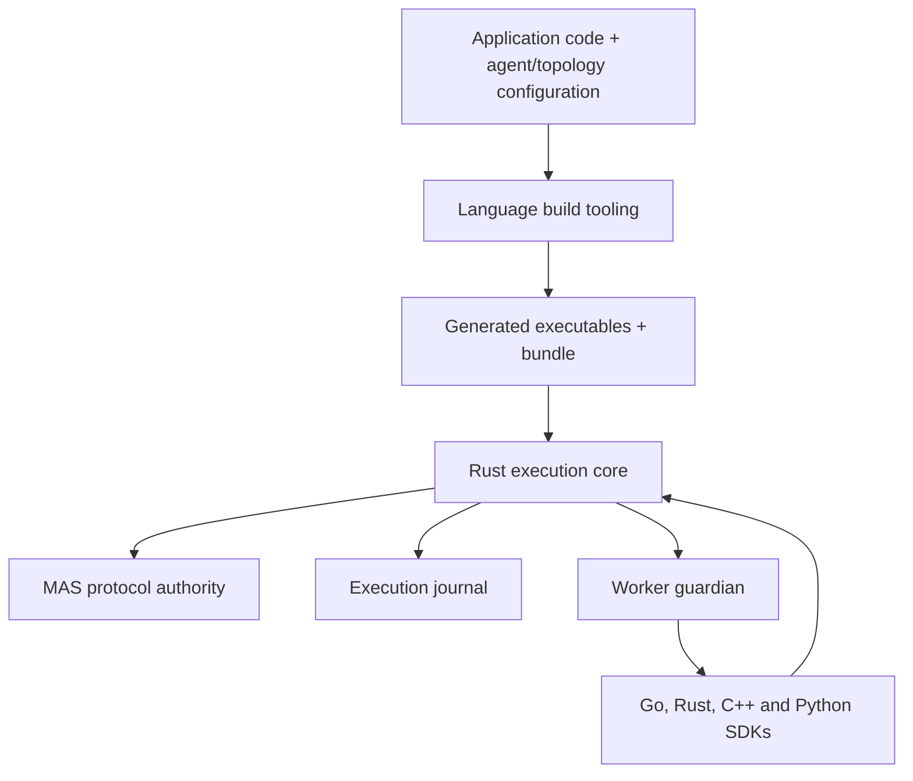

# Host architecture

## Purpose and boundary

An application should contain its solution, its agent bindings, its permitted
communication routes, and ordinary language build files and tests. MAS-specific
transport, process launchers and registration manifests are generated by tooling
maintained in this repository. Python is an optional application language;
the shared host remains Rust, and other language profiles require no Python runtime.

`mas` and `mas-host` have independent responsibilities and release histories.
This host consumes the public Rust `mas-protocol-codec` crate at commit
`9d9845990843f5e3464395da7bd60bb50ffb2dda`. It does not copy or modify the protocol
implementation. The dependency is pinned source while independently published
protocol releases are unavailable. `Cargo.lock` records the complete Rust graph.

| Owner | Responsibility |
|---|---|
| MAS protocol | Message grammar, task transitions, permitted routes, mailboxes, call reservation and expiry |
| Host core | Bound application identity, execution records, replay, uncertain effects and administrative resolution |
| Worker supervisor | Private channel, original deadline and descendant cleanup |
| SDK | Language-native context, codecs and error conversion |
| Build integration | Generated entry point, handler binding, executable build and bundle |
| Application | Business decisions, durable step names, joins, acceptance and effect meaning |
| Operator | Trusted code, credentials, deployment environment, evidence for reconciliation and retention |

Workers receive neither protocol database handles nor authority to choose a
sender identity. The host derives the sender from the invocation that owns the
private channel. MAS performs route admission on actual Request/Result exchanges.

## Design choices

One shared Rust core gives every language the same admission and recovery
semantics. Separate full hosts would multiply the persistence and recovery
implementations that must agree. A Python factory layer would retain the
integration dependency that motivated this project. The shared process contract
avoids a required C ABI or cgo dependency; embedding can be added if measured
requirements justify its separate lifecycle and ABI obligations.

The code is a new local host implementation, with the existing host as a
behavioural reference. It does not migrate or reinterpret the existing host's
databases. Protocol, host IPC, application configuration and generated bundle
formats are independently versioned. A changed executable, bundle or root input
cannot silently resume retained work.

Application bindings use `mas-agents/3`; generated worker records use
`mas-bundle/3` and always carry a public operation, environment scope and working
directory. Input/output schemas belong to operations and are enforced for every
implementation kind. Only source-function workers carry a handler binding. TOML/YAML authoring and typed
SDK builders feed the same resolved configuration. Strict JSON remains the
generated bundle and worker-frame representation.

The first profile deliberately uses the existing public protocol store API.
The protocol database rejects unrelated tables, so the host maintains a separate
execution journal. Durable intent precedes call reservation; durable admission
precedes worker permission. Recovery handles gaps conservatively. This is a
single-owner process protocol, not a distributed transaction or high-availability
service. A later shared-storage implementation must preserve atomic admission,
ownership fencing and original deadlines before claiming distributed support.

## Application execution

A typed Go or Python function, or a supported Rust/C++ JSON-object function, becomes an
agent handler through its agent configuration binding. The build tool writes its
worker entry point and bundle under `.mas/build/`. Those generated files are not
application source and should not be committed.

Topology is an explicit permission graph. The application calls another actor
through its context, names the durable step, and decides how the result affects
the solution. A `parallel` request joins a bounded group in input order. A loop
belongs in application code, with distinct stable keys per iteration and a
business stopping condition. Runtime message and time limits bound execution.

The replay unit is a named request or admitted effect. After interruption,
incomplete orchestration code may restart. Recorded child results are reused.
This requires deterministic orchestration outside effect boundaries. Arbitrary
threads, goroutines, file writes or network calls do not become durable merely
because their containing function is hosted.

Authoring readers are format adapters selected by extension or an explicit CLI
option. They produce the same MAS value domain before schema, topology and
workflow validation. This keeps file syntax out of admission and recovery.
JSON parsing for native messages and persisted bundles remains a separate
strict boundary. Native builders select cohesive Go, Rust, C++ and Python
backends; Python adds a source archive without a second host implementation.
The [authoring contract](authoring.md) specifies the conversion and identity rules.

An effect descriptor identifies all behaviourally relevant parameters without
credentials. The context requests admission, executes only when authorised, and
records output with evidence. An interrupted admitted effect remains uncertain.
The host blocks successful completion until evidence resolves that uncertainty.
An operator-supplied resolution is an assertion about the outside world, not an
observation made by MAS. No retry or exactly-once guarantee is inferred from it.

## Initial supported domain

The implemented target is a trusted local Linux deployment, with native
executables and a bounded single-run process owner. Go uses typed application
functions and standard modules. Rust and C++ initially use standalone source
functions with the SDK's JSON value type. Whole-workspace Rust dependencies,
CMake target discovery and arbitrary native type-to-schema derivation are later
build profiles, not hidden requirements met by the present generator.

Python supports module files inside an application project, dataclass input and
output adapters, and explicit configuration builders. The generator freezes
application Python sources and the SDK into a deterministic executable archive,
and binds the interpreter selected at build time. Third-party packages remain
installed in that interpreter's environment and require deployment pinning.

The worker guardian supplies process supervision and resource ceilings; it is
not an isolation boundary for hostile application code. Code runs with the local
operator's filesystem permissions. Generated binaries and their dependencies
must be treated as immutable for a retained run. Shared libraries and runtime
environment need deployment pinning in addition to the executable digest.

Maintained LLM and workflow implementations are described in
[LLM agents and composition](llm-workflows.md). There is no remote service ingress,
credential manager, human approval queue, distributed scheduler or migration from
Python-host state. Model credentials use explicitly scoped environment references. The
configuration rejects unsupported languages and fields instead of silently
falling back to Python or unrestricted execution.

## Qualification and extension sequence

The acceptance suite must exercise an application repository without handwritten
transport or registration code in each supported language. It must also verify
route admission, result reuse, changed identity
rejection, a lost effect response, evidence-based resolution, call-budget
enforcement, expiry and descendant cleanup. Successful sample output alone is
insufficient evidence for recovery behaviour.

Further releases should extend these boundaries in this order:

1. Publish signed host distributions containing generators and SDK assets; consume
   released protocol packages with a tested compatibility matrix.
2. Add full Cargo/CMake build profiles and type-derived schemas while retaining
   the same worker contract. Explicitly version any wider numeric profile.
3. Add maintained effect integrations with documented provider idempotency,
   evidence and credential binding. Generalise agent implementation kinds only
   alongside their executable contracts.
4. Add authenticated service ingress and deployment grants independently of
   application configuration. Then qualify shared storage, leases and ownership
   fencing before allowing multiple host owners.
5. Add richer durable workflow/human-input APIs if application evidence shows the
   named-request model is insufficient. Preserve explicit business control flow.

The repository split is already real: this project builds from a pinned remote
dependency rather than a sibling MAS checkout. Existing `mas`, `mas-demo` and
examples remain independent consumers or references.

## Command adapters and repository ownership

The configuration resolver produces typed native, command, LLM and workflow
variants. Native builders own source/function binding; the command builder owns
retained tool files and executable identity. Every variant resolves to the same
supervised worker contract. The core reads launch properties without inspecting
provider-specific configuration.

A maintained command adapter owns argument binding, stdin/stdout conversion and
external-outcome classification. Provider adapters and the command adapter share
bounded process I/O through `mas-host-process`; the existing Linux guardian owns
all descendant cleanup. Operation schemas share `mas-host-schema` across the
resolver, core and runtime. These shared components have no protocol-store or
workflow dependencies.

Application demonstrations belong in `mas-host-examples`. Local `tests/fixtures`
retain only inputs required to verify this host's compiler integration and recovery.
Changes to the current authoring and bundle contracts migrate those fixtures and
the examples together; prior schemas are rejected rather than maintained in parallel.
